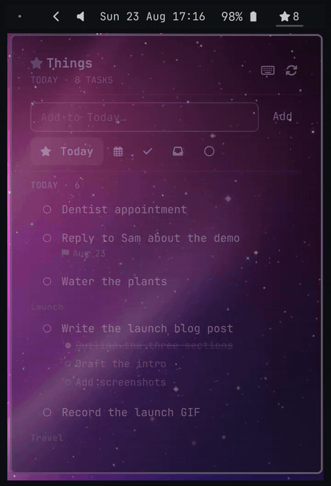
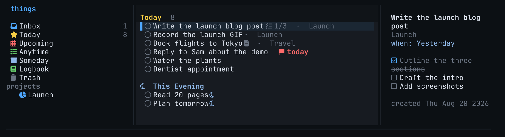

# Things — Omarchy bar widget

[Things 3](https://culturedcode.com/things/) in your Omarchy bar: task counts
at a glance, a full panel to work the list, and a "now" task pinned right in
the bar — all synced with Things Cloud, so it's the same data as your Mac and
iPhone apps.



## Features

- **Five views** — Today ★, Upcoming 🗓, Done today ✓, Inbox, and Projects ○
  with Things-style pie progress per project (click a project to drill into
  its open tasks). Upcoming groups by the day each task actually falls on
  ("Tomorrow", "Mon Aug 24"). The selected tab shows its name, the rest are
  icons, so all five fit.
- **Bar pill** — shows the current view's icon + count. Left-click opens the
  panel, middle-click cycles views, right-click forces a cloud sync.
- **Work the list** — check tasks off (un-check from Done), quick-add (goes
  to Today, the Inbox, or the open project), rename inline, move between
  Today / This Evening / Tomorrow / Anytime / Someday / Inbox / any project,
  delete with confirmation.
- **Type a date** — the When… picker takes a typed date as well as the five
  presets: `saturday`, `this fri`, `next sat`, `next week`, `in 3 days`,
  `aug 24`, `12/25`, `2026-09-01`. A live preview spells out the result
  ("Enter → Sat Aug 29") before you commit it.
- **Quick-add grammar** — one line carries the lot: `buy milk @next saturday
  #groceries +errand !aug 24 -- some notes`. `@` sets when, `!` or `--due`
  the deadline, `#` the project or area, `+` a tag. A preview under the field
  shows what it parsed.
- **Notes at a glance** — a task with notes shows one faint line of them
  under the title. A pasted link renders as its host and path and opens in
  your browser when clicked.
- **Pin a "now" task** — right-click → Pin puts the task's title in the bar
  (`▶ …`, ellipsized). One pin at a time; finishing or deleting the task
  clears it. The pinned row wears a dotted outline in the list.
- **Instant + smooth** — every action is optimistic: new tasks slide in at
  the top (and are reordered to the top server-side), completed/moved/deleted
  rows collapse in place, and background syncs reconcile without ever
  touching your scroll position.
- **Full keyboard control** — see the `?` help card in the panel. Highlights:
  arrows/`j·k` move, `Space` checks off, `Tab` hops between quick-add and the
  list, `Shift+Tab` cycles views, `t`/`u`/`d`/`i`/`p` jump straight to
  Today / Upcoming / Done / Inbox / Projects, `s`/`m` schedule and move,
  `e`/`x` rename and delete, `Shift+P` pins, `o` opens the full app for
  anything the panel deliberately leaves out (notes body, checklists).

## Install

```sh
omarchy plugin add https://github.com/reysu/omarchy-things --enable
~/.config/omarchy/plugins/reysu.things/setup
```

The first command installs the widget and asks which bar section to place it
in. The second builds the bundled Things Cloud CLI (first run only), asks for
your Things Cloud email and password (the same account as your Mac and iPhone
apps), and runs the first sync — when it finishes, your tasks are in the bar.

Optional Hyprland keybind to toggle the panel from anywhere:

```lua
o.bind("SUPER + SHIFT + T", "Things tasks", "qs -p /usr/share/omarchy/shell ipc call reysu.things toggle")
```

Companion app: [things-tui](things-tui/) ships in this repo — the same data
in a full terminal UI, plus an ALT+SPACE quick-add popup (grammar shared with
the panel). Install it with `things-tui/linux/install.sh` (macOS:
`things-tui/macos/install.sh`).



## Remove

```sh
omarchy plugin remove reysu.things
sudo rm -f /usr/local/bin/things3      # the CLI `setup` built
rm -rf ~/.local/state/things3          # Things Cloud login + local cache
```

Nothing here touches Things Cloud — your tasks stay in the Mac and iPhone apps.
If you added the `SUPER + SHIFT + T` keybind, delete that line from
`~/.config/hypr/bindings.lua`.

If you also installed the companion app:

```sh
pipx uninstall things-tui             # or: rm -f ~/.local/bin/things-tui
rm -f ~/.local/share/applications/things.desktop
rm -f ~/.local/share/icons/hicolor/scalable/apps/things-tui.svg
```

## Requirements

Nothing beyond what `setup` handles. The Things Cloud CLI ships in this repo
at [`things3-cloud/`](things3-cloud/) — a fork of Evan Purkhiser's
[things3-cloud](https://github.com/evanpurkhiser/things3-cloud) (MIT) —
and `setup` builds and installs it.

> **Why bundle a fork?** The released CLI (0.8.3) only understands the
> `Task6` wire entity. Newer Things clients also emit `Task7` — an identical
> property set, just a version bump — and stock builds silently discard those
> records, so to-dos and completions made on those devices never appear.
> The bundled copy carries our fix.

A Nerd Font in the bar (Omarchy's default setup qualifies).

`setup` compiles that CLI with `cargo` and needs **sudo once** to place the
binary at `/usr/local/bin/things3`. If `cargo` or `jq` are missing it installs
them with `omarchy pkg add`. It writes no user configuration; the only state it
creates is your Things Cloud login and cache under `~/.local/state/things3`.

## How it syncs

Fetches run `things3` against Things Cloud: a full refresh (panel open +
every 10 minutes) syncs and rebuilds everything including project progress;
action reconciles are lighter syncs. All mutations go through the CLI
(`new`, `mark`, `edit`, `schedule`, `delete`, `reorder`), so changes show up
on your other devices immediately.

State (active view, pinned task) lives in
`~/.local/state/omarchy/reysu.things/settings.json`.

## License

MIT
