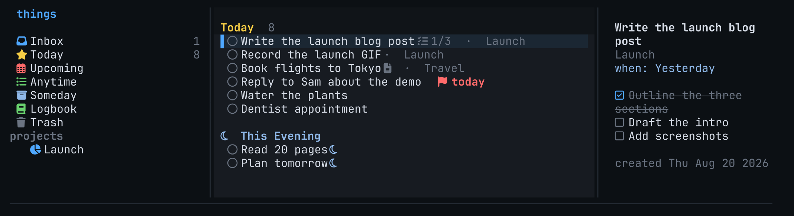

# things — a Things 3 clone for the Linux terminal

*The companion app of [omarchy-things](../) — the Things 3 bar widget for Omarchy.*

A keyboard-and-mouse TUI (Textual) that mirrors Things 3's organization, backed
by the `things3` cloud CLI (`things3-cloud` package), so everything stays in
sync with Things Cloud — the same data your Mac/iPhone apps see.



## Install

Requires Python 3.11+, a [Nerd Font](https://www.nerdfonts.com/) in your
terminal (icons are single-width Nerd Font glyphs), and the `things3` CLI
authenticated with `things3 set-auth`.

That CLI is **bundled** at [`../things3-cloud/`](../things3-cloud/) — a fork of
Evan Purkhiser's [things3-cloud](https://github.com/evanpurkhiser/things3-cloud)
(MIT). Use it rather than the released package: 0.8.3 only understands the
`Task6` wire entity and silently drops the `Task7` records newer Things clients
emit, so to-dos from those devices never appear. The installers below build it
for you, and needs sudo once to place the binary in `/usr/local/bin`.

**macOS**

```sh
git clone https://github.com/reysu/omarchy-things.git && cd omarchy-things
./things-tui/macos/install.sh   # builds the bundled CLI, then pipx installs the app
things3 set-auth
things-tui
```

**Linux (Arch/Omarchy)**

```sh
git clone https://github.com/reysu/omarchy-things.git && cd omarchy-things
./setup                         # builds the bundled CLI and logs you in
./things-tui/linux/install.sh   # pipx install + desktop entry + icon; prints the Hyprland snippet
```

Already running the bar widget? `setup` has done the CLI half — just run
`~/.config/omarchy/plugins/reysu.things/things-tui/linux/install.sh`.

Anywhere else: `pipx install .` (or `pip install .` in a venv) gives you the
`things-tui` command.

## Run

- **App launcher** → "Things" (Linux desktop entry; dedicated window, own icon)
- `things-tui` in any terminal
- `things-tui quick` → quick-add popup (bound to **ALT+SPACE** on Hyprland;
  on macOS bind it with Raycast/Hammerspoon/skhd to your terminal, e.g.
  `open -na Ghostty --args -e things-tui quick`)

## Layout

- **Sidebar** — Inbox, Today, Upcoming, Anytime, Someday, Logbook, Trash, then
  Areas with their Projects nested beneath.
- **Middle** — task list. Today splits into Today / This Evening; Upcoming
  groups by date; Logbook groups by completion day; Anytime/Someday group by
  project; project views group by heading.
- **Right** — details of the highlighted task.

## Keyboard shortcuts

Press `?` in the app for the full reference. Highlights:

| | | | |
|---|---|---|---|
| `space` / `ctrl+k` | complete | `c` / `ctrl+alt+k` | cancel |
| `n` / `ctrl+n` | new to-do | `e` | edit |
| `H` in a project | new heading | `m` | move to list or heading |
| `enter` | open task | `m` | move to list |
| `s` | schedule picker | `d` | deadline |
| `ctrl+t` | → Today | `ctrl+e` | → This Evening |
| `ctrl+s` | → Someday | `ctrl+r` | → Anytime |
| `backspace` | delete (confirms) | `ctrl+z` | undo delete |
| `/` / `ctrl+f` | search / jump to a list | `1`–`7` | switch view |
| `gg` / `G` | top / bottom | `S` / `ctrl+y` | sync now |
| `T` | toggle theme (night ⇄ terminal) | `?` | all shortcuts |
| `ctrl+b` | hide/show sidebar | `D` | hide/show detail pane |

Search (`/`) is also the jump list: every view, area and project filters live
as you type, so enter on the highlighted match opens it; the last row
(“search to-dos for …”) runs a text search across your to-dos instead. Search
results list matching lists above matching to-dos.

`g` prefix (vim-style): `g g` top · `g i` inbox · `g t` today · `g u` upcoming
· `g a` anytime · `g s` someday · `g l` logbook · `g x` trash. `G` bottom.

Mouse: click a task's `○` to complete it, click to select, double-click to
open. In the open-task view the same `ctrl+t/e/s/r`, `m`, `s`, `d` shortcuts
apply, and checklist items toggle on click.

Project headings are genuine Things Cloud headings. Press `H` while viewing a
project to create one; empty headings are shown immediately, and headings in
the current project appear as destinations when creating or moving a to-do.
They sync to the Things apps on iPhone, iPad, and Mac.

## Instant feedback

Every action (add, rename, complete, delete, schedule, move) updates the
list immediately; the cloud write and a true-up refresh happen in the
background, and you only hear about it if something fails.

## Themes

Two looks, `T` toggles live and remembers your choice
(`~/.config/things-tui/config.toml`):

- **night** (default) — the built-in dark palette.
- **terminal** — transparent: no backgrounds at all and only the 16 ANSI
  colors, so it inherits whatever your terminal theme (and opacity) is —
  Omarchy theme switches carry straight through.

`things-tui --terminal` / `--night` or `THINGS_TUI_THEME=terminal` override
the saved preference (both apps, quick-add included).

## Sync

Reads come from the CLI's local cache (instant). Mutations push to Things
Cloud immediately, then settle the cache with a follow-up sync. A background
sync pulls every 30 seconds (a change made on your Mac shows up within ~30s;
`S` forces it now). Syncing CLI calls are serialized behind a lock (they race
on the CLI's state files otherwise); `--no-sync` reads bypass it so a slow
network sync never blocks the UI.

## Deleting & undo

The cloud CLI has **no trash operation** — `delete` is permanent and skips
Things' Trash. The app therefore always asks before deleting, and `ctrl+z`
restores the last 10 deletions from in-memory snapshots (tasks fully; projects
with their live to-dos — headings and logbook history can't be recreated).
The **Trash view** shows items trashed from your other Things apps, read-only.

## Entering to-dos (n / N / ALT+SPACE)

One line, same grammar everywhere, with a live preview of what it parsed:

```
buy milk @tomorrow #groceries --due aug 24 +errand "get the oat one"
```

- `@when` — `today` · `tonight`/`evening` · `tomorrow` · `someday` · `anytime`
  · a weekday (`@fri`, `@next mon`) · a date (`@2026-08-24`, `@08-24`,
  `@08-24-26`, `@aug 24`, `@24 aug`, `@aug24`) · `@in 3 days`
- `--due <date>` (or `!<date>`, `due:<date>`) — deadline; `--due none` clears
- `#list` — project or area by substring (`#"two words"` if needed)
- `+tag` — tags, repeatable
- `"notes"` / `'notes'` — notes (or everything after a bare ` -- `)

`n` defaults to the list you're looking at (and today/someday when in those
views); `N` always goes to the Inbox. ALT+SPACE closes instantly and creates
in the background (desktop notification only on failure). `e` still opens the
full form for editing (Tab moves between fields).

Hyprland pieces: bind in `~/.config/hypr/bindings.lua`, float/center rules for
the `things.quick` app id in `~/.config/hypr/hyprland.lua` (`linux/install.sh`
prints both snippets).

## Code

`things_tui/`: `app.py` (UI), `backend.py` (CLI wrapper + state-cache trash
reader), `modals.py` (dialogs), `rows.py` (rendering), `quick.py` (popup).
`pyproject.toml` builds a wheel with a `things-tui` entry point. `bin/things-tui`
is a dev launcher that runs from the checkout's `.venv`. `linux/` holds the
desktop entry, icon, and installer; `macos/` the Homebrew/pipx installer.
